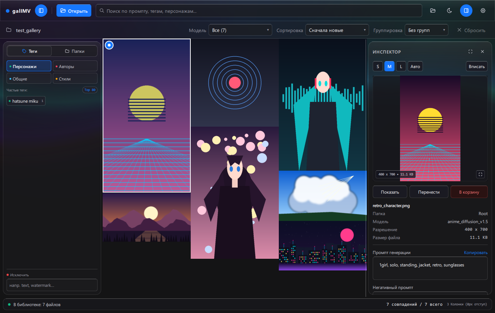
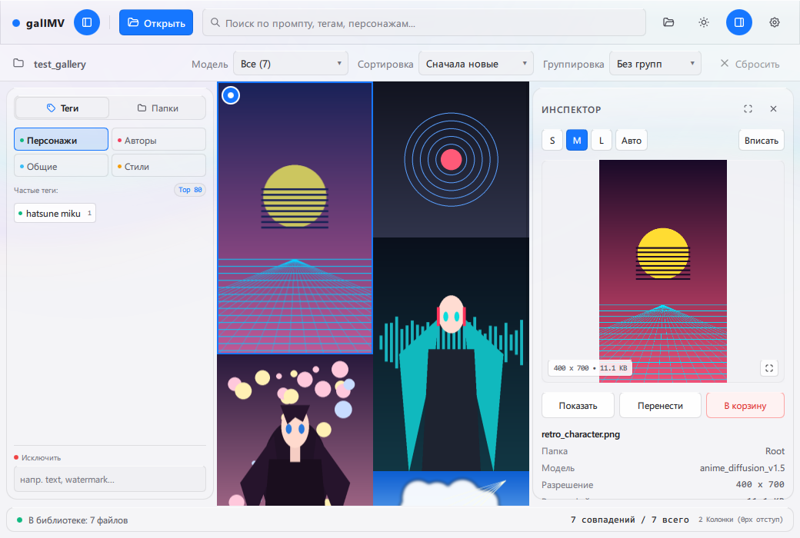
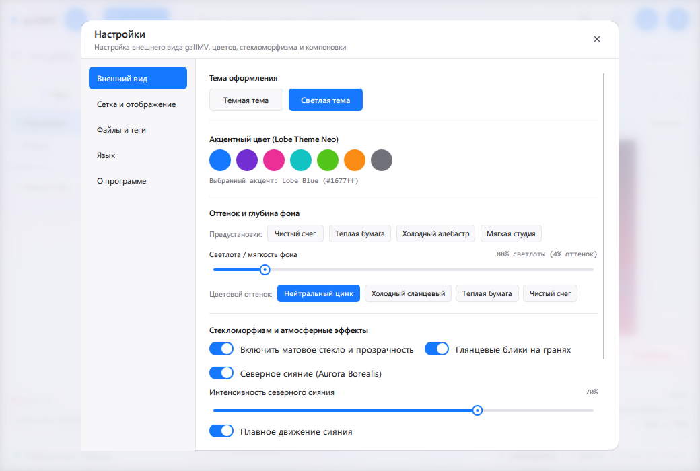
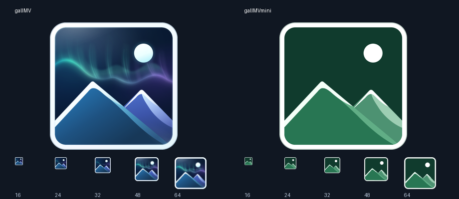

# galIMV

<p align="center">
  <strong>English</strong> | <a href="README.ru.md">Русский</a>
</p>

<p align="center">
  
  
  
  
  
  
</p>

Desktop image gallery and metadata inspector for AI-generated images. Built with C++20 and Qt 6.8 (QML). Features multi-threaded thumbnail caching, Danbooru tag search, generation parameter parsing, Lobe theme, and 20-language localization.



## Core Capabilities

### Multi-Threaded Gallery Engine
- Asynchronous directory scanning and background thumbnail rendering.
- Virtualized masonry grid view with smooth scrolling across large image collections.
- Sorting by date, file name, dimensions, and file size.
- Grouping by subfolder, generation model, or modification date.
- Multi-selection for batch review and management.

### AI Metadata Extraction
- **Stable Diffusion (Automatic1111, WebUI Forge, SD.Next)**: positive and negative prompts, seed, sampler, steps, CFG scale, model checkpoint, hash, denoise strength, LoRA tags, and clip skip.
- **ComfyUI**: recursive graph traversal extracting prompt nodes, checkpoint loaders, and sampler parameters.
- **NovelAI & Fooocus**: metadata extraction from embedded JSON payloads and PNG text chunks.
- **Midjourney**: prompt extraction and parameter structuring.

### Danbooru Tag Search
- Fast tag search powered by pre-indexed tag frequency dictionaries.
- Categorized tag badges (artist, character, copyright, general).
- Real-time tag-based filtering across folders.

### Interface & Design
- **Lobe Theme**: dark and light modes with 6 accent colors.
- **Tabler Vector Icons**: clean SVG iconography scaled cleanly to any display density.
- **Persistent Settings**: active theme, accent color, language, and gallery layout persist across restarts.





### Supported Languages (20 Locales)
galIMV provides built-in translations for:
- English (`en_US`)
- Russian (`ru_RU`)
- Simplified Chinese (`zh_CN`)
- Traditional Chinese (`zh_TW`)
- Japanese (`ja_JP`)
- Korean (`ko_KR`)
- German (`de_DE`)
- French (`fr_FR`)
- Spanish (`es_ES`)
- Portuguese (Brazil) (`pt_BR`)
- Italian (`it_IT`)
- Polish (`pl_PL`)
- Turkish (`tr_TR`)
- Ukrainian (`uk_UA`)
- Dutch (`nl_NL`)
- Indonesian (`id_ID`)
- Vietnamese (`vi_VN`)
- Thai (`th_TH`)
- Arabic (`ar_SA`)
- Hindi (`hi_IN`)

## Building from Source

### Prerequisites
- CMake 3.21 or newer
- C++20 compiler: MinGW-w64 (GCC 13+) or MSVC 2022
- Qt 6.8+ (modules: `Core`, `Gui`, `Quick`, `Qml`, `Widgets`, `Svg`, `Concurrent`)
- Ninja build system
- *(Optional)* Inno Setup 6 for building the Windows installer
- *(Optional)* 7-Zip for generating portable release archives

### Build Instructions
```bash
git clone https://github.com/LeonWGal/galIMV.git
cd galIMV

# Configure CMake
cmake -B build -S . -G "Ninja" -DCMAKE_BUILD_TYPE=Release

# Build targets
cmake --build build --config Release

# Install binaries and Qt runtime
cmake --install build --prefix dist
```

### Running the App
Run directly using the launcher script:
```cmd
run.bat
```

### Packaging Releases
Create standalone portable archives and an Inno Setup installer:
```cmd
package.bat
```

## Project Structure

```
galIMV/
├── CMakeLists.txt              # CMake build configuration
├── package.bat                 # Automated distribution packaging script
├── run.bat                     # Application launcher
├── src/                        # C++ source files
│   ├── gallery_model.cpp/h     # Multi-threaded image gallery model and caching
│   ├── metadata_reader.cpp/h   # AI metadata extraction engine
│   ├── tag_autocomplete.cpp/h  # Danbooru tag search and autocomplete
│   ├── launcher.cpp            # Lightweight Windows launcher
│   └── main.cpp                # Application entry point
├── qml/                        # Qt Quick / QML interface
│   └── main.qml                # Main gallery and inspector UI
├── locales/                    # 20 JSON localization dictionaries
├── resources/                  # Application icons, SVGs, and resource files
├── installer/                  # Inno Setup installer script (setup.iss)
├── docs/
│   └── screenshots/            # Interface screenshots
└── tests/                      # Unit and regression test suite
```

## License

This project is licensed under the MIT License. See [LICENSE](LICENSE) for details.
