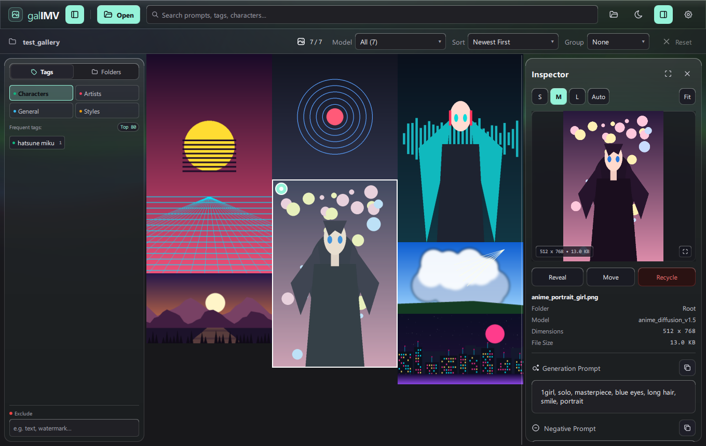
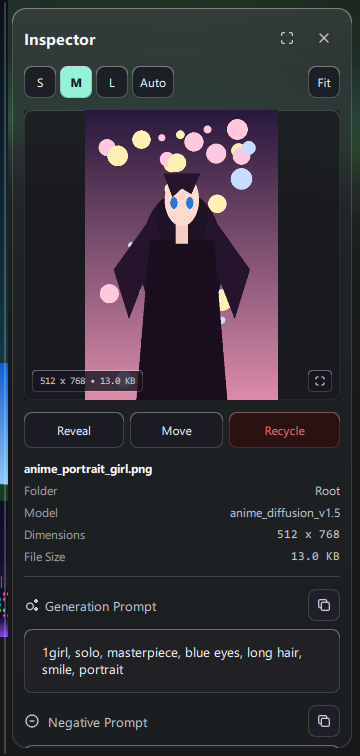
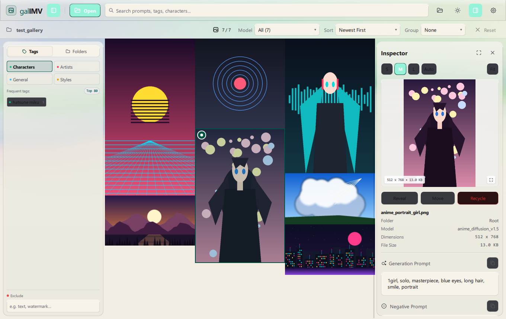
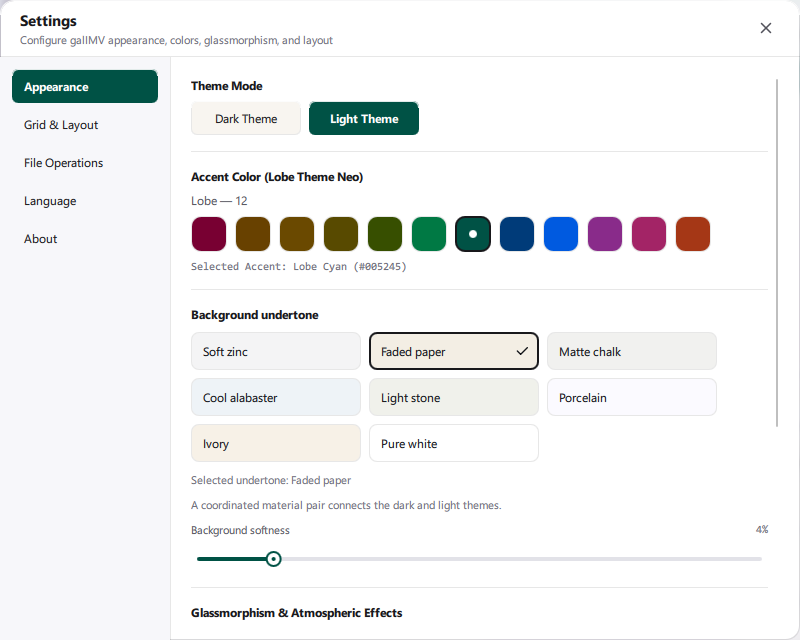

<h1 align="center">galIMV Image Metadata Viewer</h1>

<p align="center">Gallery edition · C++ / Qt Quick<br /><strong>English</strong> · <a href="README.ru.md">Русский</a></p>



<p align="center">
  
  
  
  
  
  
</p>
<p align="center">
  
  
  
</p>

Explore AI image collections and read the prompts and generation metadata stored in your files. Open a folder, narrow down the gallery, and inspect an image without leaving the grid.

## Start with a collection

Download the [Windows x64 release](https://github.com/LeonWGal/galIMV/releases/tag/v1.2.0). Run the single-file portable EXE, or extract the portable ZIP. For source code, see [Build from source](#build-from-source).

1. Run `galIMV-1.2.0-Windows-x64-Portable.exe`, or extract the ZIP and open `galIMV.exe` from its `galIMV` folder.
2. Select **Open** (`Ctrl+O`) and choose an image folder. The gallery scans it in the background.
3. Select a thumbnail. Its preview, prompt, and available generation details appear in the inspector.

## Find the image you need

Use the workspace to:

- **Browse a collection.** Use the masonry gallery, sorting, grouping, and multiple selection.
- **Filter with tags.** Search prompts and tags; use tag categories and the exclude field to narrow the results.
- **Keep context.** Resize or hide the inspector while continuing to browse the grid.

## Read the generation details

Inspect positive and negative prompts, model names, image dimensions, and the generation parameters present in the file. Copy prompts from the inspector.

<p align="center"></p>

The parser reads PNG text chunks, Automatic1111-style parameter text, ComfyUI API graphs, NovelAI prompt JSON, and companion `.txt` files. Available fields depend on what the image contains.

## Make the workspace yours

Choose a dark or light theme, 12 Lobe accents, and an application icon that follows the selected accent. Glass panels and Aurora surround the gallery; seven material pairs connect backgrounds such as charcoal and faded paper. A separate pair provides pure black and white.





## Useful shortcuts

These shortcuts cover the main actions:

| Shortcut | Action |
| --- | --- |
| `Ctrl+O` | Open a folder |
| `Ctrl+F` | Focus search |
| `B / I` | Toggle the left panel / inspector |
| `Ctrl+A` | Select all images |
| `Ctrl+,` | Open settings |
| `Space` | Preview the selected image |

## Build from source

You need a Qt-compatible C++20 compiler, Qt 6.8+, CMake 3.21+, Ninja, and zlib. Include Qt Quick, Quick Controls, Quick Dialogs, Concurrent, and Qt Test in the Qt SDK. Add Qt and compiler tools to `PATH`.

From the project folder, run:

```powershell
cmake -S . -B build -G Ninja `
  -DCMAKE_BUILD_TYPE=Release `
  "-DCMAKE_PREFIX_PATH=QT_PREFIX" "-DZLIB_ROOT=ZLIB_PREFIX"
cmake --build build
cmake --install build --prefix dist
```

Replace `QT_PREFIX` with your Qt SDK directory and `ZLIB_PREFIX` with the directory containing zlib headers and libraries. The installed application is `dist/bin/galIMV.exe`.

## Files and documentation

The application reads local images. Settings and cache are in `%LOCALAPPDATA%/LeonWGal/galIMV`; temporary files are in `%TEMP%/LeonWGal/galIMV`.

See the [shared interface guide](docs/shared-ui.md) for icons, palettes, component sizes, and checks.

Open a test image and confirm that its preview and metadata appear in the inspector. Then select your theme and interface language.

---

**LeonWGal** · [MIT license](LICENSE)
