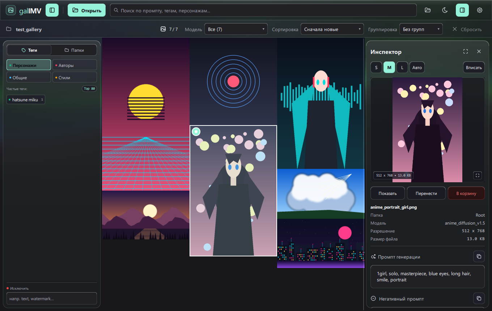
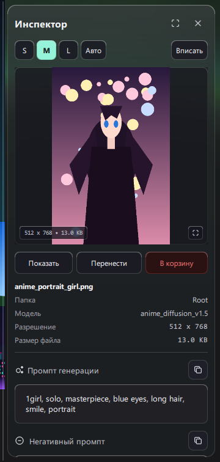
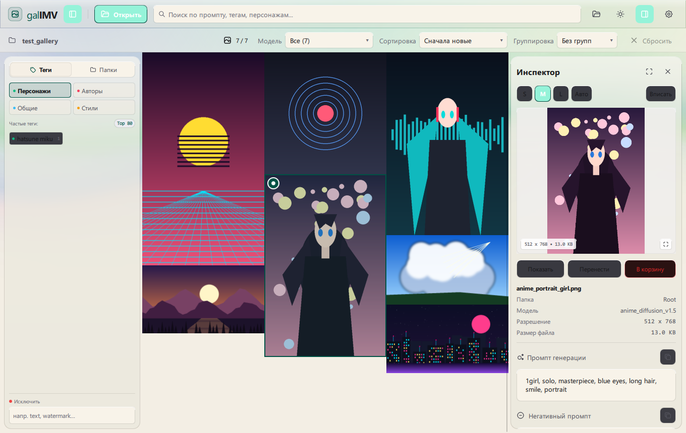
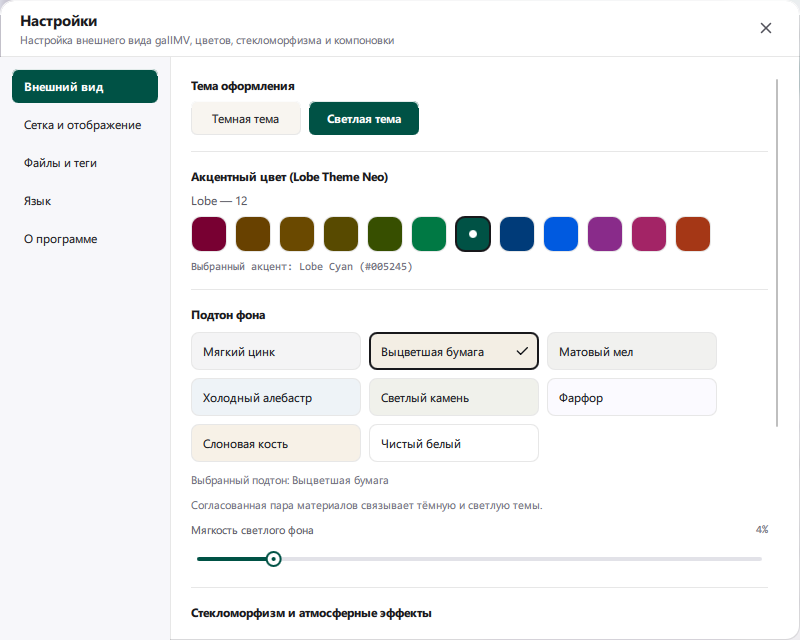

<h1 align="center">galIMV Image Metadata Viewer</h1>

<p align="center">Галерея изображений · C++ / Qt Quick<br /><a href="README.md">English</a> · <strong>Русский</strong></p>



<p align="center">
  
  
  
  
  
  
</p>
<p align="center">
  
  
  
</p>

Просматривайте коллекции AI-изображений и читайте промпты и параметры, сохранённые в файлах. Откройте папку, отфильтруйте галерею и изучите изображение в боковом инспекторе.

[Windows x64 · v1.2.0](https://github.com/LeonWGal/galIMV/releases/tag/v1.2.0)

## Начните с коллекции

Нужна подготовленная Windows-сборка. Для исходников см. [инструкцию сборки](#соберите-из-исходников).

1. Запустите `galIMV-1.2.0-Windows-x64-Portable.exe` или распакуйте ZIP и откройте `galIMV.exe` из папки `galIMV`.
2. Нажмите **Открыть** (`Ctrl+O`) и выберите папку с изображениями. Галерея сканирует её в фоне.
3. Выберите миниатюру. В инспекторе появятся превью, промпт и доступные параметры генерации.

## Найдите нужное изображение

Основные действия:

- **Просматривайте коллекцию.** Используйте мозаику, сортировку, группировку и множественное выделение.
- **Фильтруйте по тегам.** Ищите по промптам и тегам, выбирайте категории и исключайте ненужные совпадения.
- **Сохраняйте контекст.** Меняйте размер инспектора или скрывайте его, продолжая работать с галереей.

## Изучите параметры генерации

Проверяйте обычный и негативный промпты, название модели, размеры изображения и параметры, которые присутствуют в файле. Копируйте промпты из инспектора.

<p align="center"></p>

Парсер читает текстовые блоки PNG, параметры в формате Automatic1111, API-графы ComfyUI, JSON с промптами NovelAI и соседние `.txt`-файлы. Набор полей зависит от содержимого изображения.

## Настройте рабочее пространство

Выберите светлую или тёмную тему и один из 12 акцентов Lobe. Иконка программы меняет цвет вместе с акцентом. Стеклянные панели и Aurora дополняют галерею; семь пар материалов связывают подтоны вроде угля и выцветшей бумаги. Есть отдельная пара чистого чёрного и белого.





## Полезные сочетания

Основные сочетания для работы с клавиатуры:

| Сочетание | Действие |
| --- | --- |
| `Ctrl+O` | Открыть папку |
| `Ctrl+F` | Перейти к поиску |
| `B / I` | Показать или скрыть левую панель / инспектор |
| `Ctrl+A` | Выделить все изображения |
| `Ctrl+,` | Открыть настройки |
| `Space` | Показать превью выбранного изображения |

## Соберите из исходников

Нужны совместимый с Qt компилятор C++20, Qt 6.8+, CMake 3.21+, Ninja и zlib. Qt SDK должен содержать Qt Quick, Quick Controls, Quick Dialogs, Concurrent и Qt Test. Добавьте инструменты Qt и компилятора в `PATH`.

Из папки проекта выполните:

```powershell
cmake -S . -B build -G Ninja `
  -DCMAKE_BUILD_TYPE=Release `
  "-DCMAKE_PREFIX_PATH=QT_PREFIX" "-DZLIB_ROOT=ZLIB_PREFIX"
cmake --build build
cmake --install build --prefix dist
```

Замените `QT_PREFIX` каталогом установленного Qt SDK, а `ZLIB_PREFIX` — каталогом с заголовками и библиотекой zlib. Готовая программа находится в `dist/bin/galIMV.exe`.

## Файлы и документация

Программа читает локальные изображения. Настройки и кэш находятся в `%LOCALAPPDATA%/LeonWGal/galIMV`, временные файлы — в `%TEMP%/LeonWGal/galIMV`.

См. [справочник общего интерфейса](docs/shared-ui.md): иконки, палитры, размеры элементов и проверки.

Откройте тестовое изображение и убедитесь, что превью и его метаданные появились в инспекторе. Затем выберите тему и язык интерфейса.

---

**LeonWGal** · [Лицензия MIT](LICENSE)
